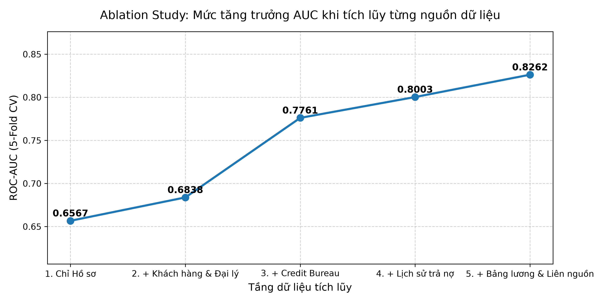

# Project Report: Consumer Credit Scoring from Multi-source Data
**Team:** TNF Finance Analytics  
**Model:** Logistic Regression Scorecard  
**Dataset:** 20,000 Loan Applications (Southern Region Retail POS)

---

## 1. Executive Summary
TNF Finance provides point-of-sale installment financing across 300 dealerships in southern Vietnam. The business previously faced a default rate around **11.86%** (~12%), while manual underwriting was both slow and subjective. 

To address this, we developed an explainable **Logistic Regression** model integrating 6 internal and external data systems:
- **Model Performance:** Achieved **ROC-AUC = 0.8262** and a **KS Statistic = 0.4972** under Stratified 5-Fold Cross-Validation.
- **Business Impact:** Using an operational approval threshold of **0.15**, the company can automatically approve **76.6%** of incoming applications while cutting portfolio bad debt from **11.86% down to 5.34%** (more than halving defaults).

---

## 2. Business Problem & Point-in-Time Principle

### 2.1. Problem Definition
- **Unit of Observation:** A loan application (`ma_ho_so`) at the time of submission.
- **Target Variable (`vo_no`):** `1` if the loan becomes 90+ days past due (DPD $\ge$ 90) within the first 12 months, `0` otherwise.
- **Data Volume:** 16,046 labeled records in Train (1,903 defaults, ~11.86% bad rate) and 3,954 unlabeled records in Test.

### 2.2. Guarding Against Data Leakage (Point-in-Time)
Real-world credit decisions only have access to information available up to application date (`ngay_nop`):
- `repayment_history.csv`: All installments ended before December 2023, while new applications started in January 2024. This table has zero time leakage.
- `payroll.csv`: Monthly salaries run from July 2023 to June 2025. **Strict filtering:** For each application, we only kept records where `payroll_month <= application_month`. No future salary data was ever exposed to the model.

---

## 3. Data Integration Strategy

The raw data was spread across 6 separate sources. We aggregated all 1-to-N relationships down to a clean 1-to-1 table per loan application:

```
[applications: 1 row / loan application]
   ├── (N:1) ──> dealers.csv (Dealer size, experience)
   ├── (N:1) ──> customers.csv (Demographics, housing, dependents)
   ├── (1:N) ──> credit_bureau.csv (Aggregated: Total external debt, monthly burden, max delinquency)
   ├── (1:N) ──> repayment_history.csv (Aggregated: Past TNF DPD max, late payments, short payments)
   └── (1:N) ──> payroll.csv (Filtered <= application date: Latest salary, salary variance)
```

### Handling Cold-start & Missing Segments:
- **No external credit history (38.9% of users):** Zeroed out bureau debt and overdue counts, flagged with `has_bureau = 0`. Interestingly, this group has a very low default rate (5.79%).
- **First-time borrowers at TNF (59.9% of users):** Filled past repayment metrics with 0 and added `is_existing_cust = 0`.
- **Informal gig economy workers (45.8% of users):** No payroll partnership records. Flagged with `has_payroll = 0` and defaulted income to self-declared amount.

---

## 4. Cross-Source Feature Engineering

Connecting independent sources revealed clear signals of risk and intent:

### 4.1. Total Debt-to-Income (DTI)
$$\text{DTI} = \frac{\text{New TNF Monthly Payment} + \text{External Monthly Debt}}{\text{Estimated Monthly Income}}$$
- *Result:* Applicants in the top DTI quartile ($> 37\%$) defaulted at **23.01%**, compared to just **5.18%** in the bottom quartile ($< 14\%$). High debt burden is a direct driver of default.

### 4.2. Income Exaggeration Factor
$$\text{Income Exaggeration} = 1 - \frac{\text{Actual Verified Payroll Salary}}{\text{Self-Reported Stated Income}}$$
- *Result:* When verified payroll was missing, exaggeration was set to 0 with a dedicated indicator. For verified applicants who exaggerated by over 33%, default jumped to **22.32%** (vs 5.66% for honest disclosures).

### 4.3. Behavioral & Contract Features
- **Down-payment Ratio (`tra_truoc / gia_tri_hang`):** Higher customer equity strongly reduced default.
- **Max Days Past Due (`repay_dpd_max`):** Prior payment delinquency at TNF remained a durable predictor of future delinquency.

---

## 5. Model Results & Ablation Study

We trained an $L_2$-regularized Logistic Regression ($C=0.1$, RobustScaler, One-Hot Encoding) evaluated using **Stratified 5-Fold Cross-Validation**.

### 5.1. Ablation Study: Cumulative Source Value

| Stage | Features | ROC-AUC (5-Fold) | KS Statistic | $\Delta\text{AUC}$ | Key Takeaway |
| :--- | :---: | :---: | :---: | :---: | :--- |
| **1. Application Only** | 9 | 0.6567 | 0.2334 | — | Self-reported data provides weak standalone signal. |
| **2. + Customer & Dealer** | 20 | 0.6838 | 0.2686 | +0.0271 | Adds demographic stability and dealer channel quality. |
| **3. + Credit Bureau (CIC)** | 26 | **0.7761** | **0.4131** | **+0.0923** | **Largest single jump (+9.2%).** External indebtedness is vital. |
| **4. + Repayment History** | 34 | 0.8003 | 0.4510 | +0.0242 | Reaches standard banking threshold (AUC $\ge 0.80$). |
| **5. + Payroll & Cross Features** | 41 | **0.8262** | **0.4972** | +0.0259 | **Best performance.** Catches income fraud and true DTI. |



### 5.2. Data ROI Takeaway
External Credit Bureau data provides the highest return on investment. Without it, the model struggles to identify over-leveraged borrowers. Payroll data and cross-source metrics (DTI & Exaggeration) deliver the second-highest boost, providing critical protection against application fraud.

---

## 6. Operational Recommendations & Next Steps

### 6.1. Setting the Decision Cut-off
Evaluating the out-of-fold probability distribution gives the business clear operational trade-offs:

| Cut-off Threshold | Approval Rate | Portfolio Bad Rate | Defaulters Caught (Recall) | Recommended Policy |
| :---: | :---: | :---: | :---: | :--- |
| **0.10** | 65.6% | 3.96% | 78.1% | Conservative / tight credit stance. |
| **0.15 (Balanced)** | **76.6%** | **5.34%** | **65.5%** | **Recommended baseline.** Keeps volume healthy while cutting default rate by 55%. |
| **0.20** | 83.2% | 6.36% | 55.4% | Growth / market expansion stance. |

- **Instant Approval (STP):** Applications with $P < 0.15$ can be approved instantly at the retail counter.
- **Manual Referral:** Applications with $P \ge 0.15$ can be declined or escalated to request additional co-signers or down payment.

### 6.2. Practical Data Insights
- **Repeat Borrowers Aren't Always Better:** Repeat customers actually had a slightly higher baseline default rate (13.2% vs 10.9% for new). Customers with past late payments who return for new credit pose significant risk. Repeat status alone should never grant an auto-pass.
- **Product Risk Divergence:** Motorbike loans carry the highest default risk (13.58%) due to larger ticket size and longer terms (18–24 months), whereas mobile phones have the lowest default (10.70%) due to short durations and high personal utility.

### 6.3. Limitations & Model Maintenance
1. **Unverified Freelancers:** About 46% of applicants lack official payroll records. TNF should explore alternative data sources (telecom credit scoring or utility bills) to better serve this segment.
2. **Monitoring Stability (PSI):** Monitor Population Stability Index (PSI) monthly. If applicant volume or product mix shifts significantly (PSI > 0.25), the model should be refreshed.

---
**Submission Deliverables:**
- Predictions File: `outputs/du_doan.csv` (3,954 rows with predicted default probabilities).
- Runnable Pipeline: `notebooks/credit_scoring_pipeline.ipynb` (End-to-end executable code).
